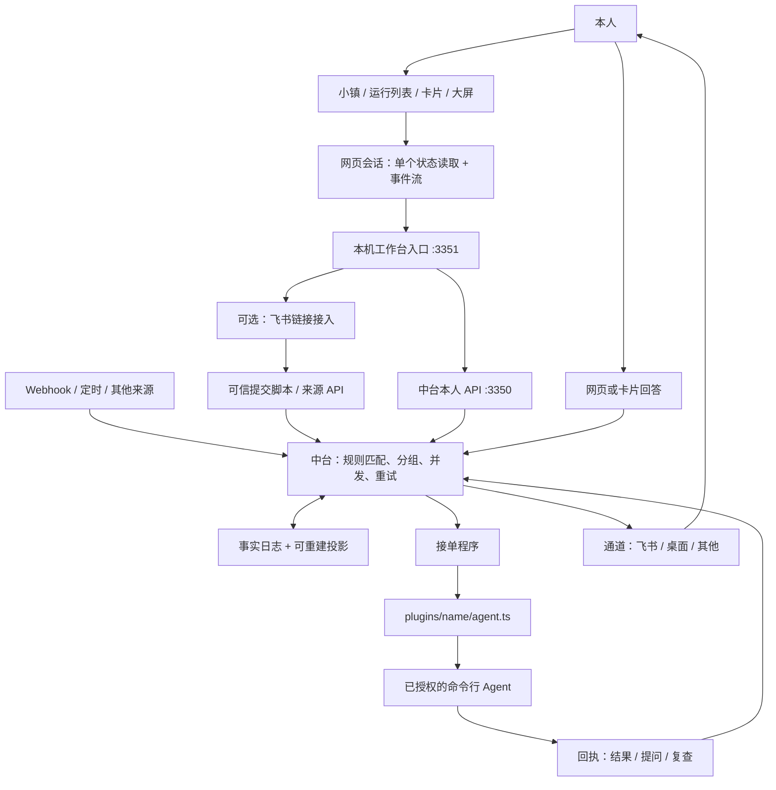

# 工作台与自动化系统架构

本文描述此分支的实际实现和与独立中台的边界。核心协议以 [protocol.md](protocol.md) 为准，启动操作见 [workbench.md](workbench.md)。

## 端到端链路



小镇只是同一份中台状态的入口。派单站展示真实规则和队列，工坊展示实际执行器配置；网页不创建另一套任务数据库或调度器。浏览器关闭或工作台进程退出后，独立中台、接单程序和通知通道可以继续运行。

## 职责与代码归属

| 层 | 负责 | 代码入口 |
| --- | --- | --- |
| 展示 | 小镇、运行列表、卡片和大屏；显示最后已知状态 | `web/src/town.tsx`、`overview.tsx`、`workbench.tsx`、`board.tsx` |
| 网页状态 | 单次并发读取、断线恢复、会话清理；视图间传递选中项 | `session-controller.ts`、`session.ts`、`selection.ts` |
| 网页通信 | 固定每个请求的凭据、超时、SSE 游标和重连；不自动重试写请求 | `transport.ts`、`hub.ts` |
| 本机入口 | 临时会话、同源限制、接口白名单、静态资源、本人 API 转发 | `scripts/workbench.ts` |
| 场景接入 | 校验飞书链接、调用本机可信脚本、合并相同的在途提交 | `scripts/workbench/intake.ts` |
| 中台 | 鉴权、规则载入、状态投影、时间和 I/O；核心决定只产生事实 | `host/`、`kernel/`、`protocol/` |
| 执行与通知 | 领取、保存执行状态、调用 Agent、提交回执、送卡和接收回答 | `worker/`、`plugins/` |

插件发现仍然只有 `plugins/<name>/{agent,channel,source}.ts`，安装目录优先。实训营入口是现有可信脚本的本机桥接，不是另一套插件发现机制。业务资料、授权和产物目录由私有配置管理，不写入公共仓库或内核。

## 部署与版本兼容

可以把此仓库的工作台单独连到既有中台。工作台通过数据目录中的 `config.json` 取得本机中台地址和本人密钥，不直接打开数据库。实际中台版本决定功能；更新网页不会升级中台。

当前已验证的两种组合：

| 能力 | 此分支中台 | 官方 1.8.2–1.8.4 中台 |
| --- | --- | --- |
| 状态、历史、经过、事件流 | 有 | 有 |
| 卡片回答、结案、停止 | 有 | 有 |
| 规则运行、暂停、恢复 | 有 | 有 |
| 本人事件 `/v1/emit` | 有，需要 owner 来源规则 | 无 |
| 暂停事件补跑 `/replay` | 无 | 有 |
| 实训营链接入口 | 本机额外配置 | 本机额外配置 |
| 内置 Agent 适配器 | Codex、Claude、ACP、DSH、command；另有 delivery | 另含 ZCode；以实际安装为准 |

网页根据 owner 来源规则决定是否显示手动接单；这不是通用的能力协商。补跑只在恢复响应报告被跳过事件时出现；不支持的接口会给出明确错误。工坊里的其他接入方式仅为参考，不等于已安装或已经可用。

“在线”表示接单程序近期访问过中台。一台接单电脑可以承载多份 Agent 配置；两份配置在线不代表两台独立机器，也不证明模型授权可用。生产启用前应分别完成安装、登录、规则校验、隔离试跑和真实任务验收。

## 状态一致性与故障处理

- **唯一记录源**：来源事件和 Agent 回执进入中台，事实日志决定任务状态，投影可重建。网页不补写数据库。
- **单个读取请求**：同一会话同时只有一次状态读取。事件在 350ms 窗口内合并；读取期间的新事件安排一次后续更新，避免并发请求互相覆盖。
- **可恢复连接**：先取得有效快照，再从其 seq 接事件流；初次读取失败不会从零回放全部历史。失败按 0.5、1、2 秒逐步退避，最长 15 秒。状态读取失败或事件流断开都会显示离线，保留上次数据。
- **会话隔离**：退出或切换登录会中止读取、关闭流、清除重试计时器及页面选择。旧请求的 401 不会清除新凭据，迟到的旧结果不能更新新会话。
- **写入不盲目重试**：普通请求限时 15 秒；本机中台转发限时 6 秒。实训营脚本限时 90 秒，网页等候 95 秒。写请求超时只能表示结果未确认，应先查看记录。
- **事件去重**：手动事件在当前页面内保留同一未确认提交的编号，重试由中台去重。收到确认或修改内容才生成新编号。刷新页面不保留该编号。
- **接单并发**：同一个工作台进程内，相同飞书链接与方案的在途提交共用结果，最多同时读取两份不同提交，超出返回繁忙；不再建立第二套业务队列。跨进程及后续提交的持久去重仍由来源脚本生成稳定事件编号和中台负责。
- **回答一致性**：网页与飞书使用同一张卡片，只有第一次有效回答生效。回执和接续仍由中台处理；接入模块只读取任务并投递事件。

## 扩展方式

1. **增加任务来源**：先确定事件类型和稳定编号，再配置可信规则，规则决定执行器、目录、权限和交付方式。外部文档只提供资料。
2. **增加 Agent**：优先使用已有适配器，或按 [插件契约](plugins.md) 增加 agent.ts。配置接单电脑与规则后执行 doctor/check 和独立试跑，不以地图出现图标作为接入完成。
3. **增加业务场景**：资料提取和产物要求放入来源、规则、Skill 或已有脚本；调度仍交给中台。[实训营团队](../examples/recipes/bootcamp-team/README.md)使用已登记来源、15 分钟检查、稳定事件编号及角色回执完成分发与汇总，仍保留“本地三份草稿、本人审核”。登记文件只保存来源范围与已确认接单的指纹；运行状态、队列和失败重派属于中台。
4. **增加通知通道**：沿用 channel.ts 和卡片协议；验证送达、回答和接续。已在线飞书应用只保留一个事件消费者。
5. **更新中台**：先在临时数据目录跑兼容检查，再做备份和切换。不能直接用工作台分支覆盖较新的生产中台。

## 本次优化与验证

变更集中在网页会话、通信、本机接入与视图依赖；实训营团队作为外部配方接入。未修改中台的规则判断、数据库和 Agent 执行契约。

新增行为回归覆盖：单个读取请求、事件突发补读、初次失败退避、会话切换取消、旧 401、停止流后的迟到响应、未确认事件沿用编号、实训营并发去重与无效输入。原工作台集成测试覆盖鉴权、跨站拦截、卡片答复及结案、规则运行与取消。

```text
npm run typecheck
npm run build
node --test tests/web-session.test.ts tests/web-transport.test.ts tests/workbench-intake.test.ts tests/workbench.test.ts
npm run test:windows
```

浏览器隔离验收覆盖五处建筑、派单、卡片回答接续、历史经过、实训营模拟提交、暂停/恢复/补跑、大屏和窄屏。真实环境只读验收，避免为架构调整发送飞书消息或重新生成业务材料。

官方 v1.8.4 升级另外验证了备份数据加载、旧版数据兼容、官方运行时的角色回执链路及独立小镇兼容。实训营新增测试覆盖登记名单边界、失败后检查点、并发提交、三文件交接和汇总问答续办。真实环境完成登记方案读取、手动及计划检查、无变化的结构化提交；未为测试重做历史业务草稿。模型生成的质量仍需在新业务任务中验收。

## 尚未实现的能力

- 中台还没有统一能力协商接口；版本差异按上述矩阵管理，后续应由中台声明接口能力，再逐步替换兼容判断。
- 实训营入口已支持结构化接单回执，保留旧脚本中文回执兼容；网页尚无登记名单编辑界面，单项停用在私有登记文件中管理。
- 网页尚无 Agent 安装、登录或规则编辑向导；对应操作仍在可信本机配置中完成。
- 当前分发是规则匹配及队列执行，尚无可视化依赖编排、动态模型选择或多租户权限体系。

