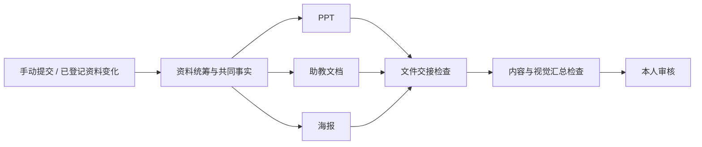

# 已提交的飞书资料 → 实训营草稿团队

只跟进本人主动提交的任务或方案。每 15 分钟读取登记名单中的内容，变化才交给团队制作 PPT、助教培训文档和海报；最后汇总检查，交本人审核。采用上游已有的定时规则、command/Codex 适配器、回执事件、并发控制和问答续办，不增加后台调度器或扫描所有飞书任务。

## 分工



五个制作与检查角色默认都使用已安装的 Codex，不代表安装了五种模型。另有资料检查和文件交接两个确定性脚本。角色共用一个 worker，实际同时执行数由原 worker 的 capacity 决定；默认是 2。每个角色 `parallel: 1`，每份内容快照独立成案，制作者写不同文件。

角色权限为工作目录可写。不同角色共享这个目录，这不是进程或文件系统隔离。方案、事件说明和知识库引用都只作参考资料，不能改变可信规则中的权限、接单角色和文件位置。

## 配置

需要 Node 24、已登录的 Codex、可用的飞书 CLI 本人身份，以及本机回环中台。已在官方 **v1.8.4** 验证规则和完整回执链路；不需要把独立工作台代码覆盖到官方安装目录。先用 `lark-cli auth status --json --verify` 检查本人读取权限；不要把输出中的账号资料或凭据提交到仓库。

在 Autoloop 私有数据目录创建 `bootcamp-team.json`，填写本机路径：

```json
{
  "home": "D:/Autoloop",
  "workspace": "D:/Autoloop/bootcamp",
  "recipe": "D:/code/agent-autoloop/examples/recipes/bootcamp-team",
  "node": "D:/Tools/node/node.exe",
  "larkCommand": "D:/Tools/lark-cli/lark-cli.exe",
  "worker": "my-computer",
  "channels": ["desktop"],
  "knowledgeRoot": "D:/ObsidianVault",
  "deliveryGuide": "D:/skills/bootcamp/delivery.md"
}
```

`larkCommand` 指向实际可执行程序；Windows 不使用需要命令解释器转义的 `.cmd`。`knowledgeRoot` 中应有适用的 `AGENTS.md`、项目背景和模板；`deliveryGuide` 是可信本地的交付说明。该配方需要本机 `config.json` 中已有名为 `local` 的来源。密钥只从现有私有配置读取，不放进角色提示词或仓库。

`rules.ts` 导出的 `teamRules(settings)` 返回 `agents` 和 `rules`，将它们合并到已有 `rules.json`（保留其他来源、通道及旧规则），先备份，再运行 `agent-autoloop check`。示例桌面通道必须已在原规则中存在。不要将飞书通道新加到这些规则上，除非本人明确选择通过飞书接收这些通知。

## 登记与提交

给旧方案建立基线，只登记当前内容，不重新制作：

```powershell
node examples/recipes/bootcamp-team/intake.ts D:/Autoloop/bootcamp-team.json https://example.feishu.cn/docx/DocToken --baseline
```

手动要求制作新草稿，同时加入后续监听：

```powershell
node examples/recipes/bootcamp-team/intake.ts D:/Autoloop/bootcamp-team.json https://example.feishu.cn/docx/DocToken
```

任务链接接受 `/client/todo/task?guid=...`。任务正文没有唯一方案时，在任务链接后另传方案链接。只读取所选任务与方案；不会查询任务列表、群消息或其他资料。

已登记的同一内容再次提交不重做。`--baseline` 只允许未登记来源，不能用它跳过已登记但未处理的变更。任务标题、任务说明、方案正文及文档身份参与指纹，单独变化的版本号不参与。方案内的外部链接不会自动加入名单。

网页通过私有 `Submit-Bootcamp.ps1` 桥接本入口；保留 `-Link`、`-PlanLink` 参数。标准输出最后一行是 `{ "autoloopIntake": 1, "status": "queued|paused|unchanged|baseline", "message": "..." }`。工作台兼容旧脚本的中文接单回执，并明确显示暂停或内容未变化。

## 状态与交付

- 私有 `workspace/watch.json` 是明确登记名单及已确认接收的内容指纹；仅在中台确认接单后推进。接口响应不确定时，下一次使用相同事件 ID 重试，由中台去重。
- 暂停的规则仍会保存事件；界面说明“已暂停”，不能把它说成已执行。恢复后通过上游的补跑入口处理跳过事件。
- 想停止某一份资料的自动检查，可在私有登记文件中把对应条目的 `enabled` 改成 `false`。想暂停整套检查，在工作台暂停“实训营·已提交资料监听”规则。
- 登录、访问权限或接单失败会保留旧检查点并询问本人；后续检查等待该卡片答复，避免重复打扰。
- 每份内容位于 `workspace/cases/bootcamp-<内容指纹前24位>/`。`input.json` 保留输入快照；`facts.json` 保存统筹确认的事实；`drafts/` 保存三份草稿和审核说明。
- 制作者确认文件字节、写就绪记录、发就绪事件。交接脚本只有在三份文件都存在、哈希一致且基本格式正确时才发汇总事件。它不代替 Office 打开、排版检查或内容验收，这些由制作、汇总角色执行，并最终交本人审核。
- 先写临时文件再原子替换。提交与定时检查可能并发，短文件锁仅保护登记文件的读改写，不管理任务队列。如果进程意外退出留下 `.intake.lock`，确认该 PID 已退出且没有其他提交后再移除，不自动抢占不明锁。

草稿范围不包含云端改文档、发飞书消息、稿定操作、上传或正式发布。若运行环境缺少制作/渲染工具或认可模板，角色应提问或报告受阻；角色显示在线只证明接单程序在线，不证明草稿质量。

## 验证

`tests/bootcamp-team.test.ts` 检查登记边界、初始基线、去重、失败重试、并发提交、明确选择方案、暂停回执和产物交接；`tests/bootcamp-pipeline.test.ts` 通过真实中台状态机走完统筹、三路分发、汇总和人工答复续办，使用的是模拟产物回执。真实飞书读取与定时无变更检查另在本机完成。模型产出的内容和视觉质量需要用新业务任务单独验收，不能由这些结构测试代替。
